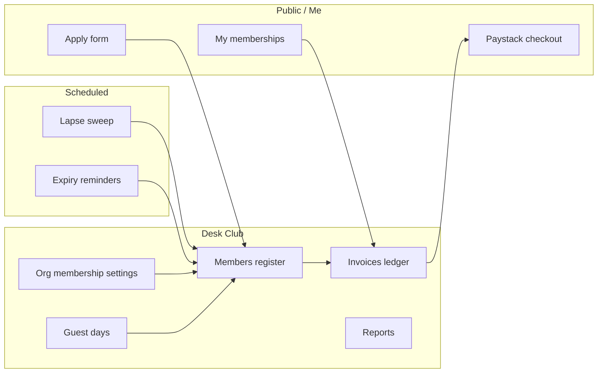

# Club Membership Manager — Design

**Date:** 2026-10-18
**Status:** Approved for build (user: all phases, hybrid payments, Playwright-tested locally)
**Plan:** `c:\Users\pchar\.cursor\plans\club_membership_manager_86af0ef3.plan.md`

## Goal

Give club Admins and Secretaries a full digital membership desk — renewals, fees, invoices, custom fields, guest days, and reports — and let linked shooters self-service via `/me`. Build on the existing `ClubMember` register instead of replacing it. Stay inside the SA stack: Desk `/desk`, public club pages, POPIA, Paystack one-off payments.

Scope sibling: Range Mate's membership slice (renewals, invoices, custom fields, guest days, member self-service, reports). Out of scope: UK police checks, FAC/SGC, NRA cards, firearms register, platform payouts.

## Decisions (locked)

| Decision | Choice |
|---|---|
| Register layer | Extend `App\Models\ClubMember` — do not rebuild |
| Renewal period | Calendar year — active membership expires **31 Dec** of the membership year |
| Payments | Hybrid — ledger always; per-club `membership_online_payments` toggle enables Paystack checkout |
| Guest days | Separate `ClubGuestVisit` records (not full members); "Convert to application" pre-fills `ClubMember` Applied |
| Custom fields | JSON schema on `organisations`, JSON values on `club_members` (no EAV) |
| Self-service | Only when `ClubMember.user_id` is linked; otherwise secretary manages |
| Lapse policy | Scheduled job flips `Active` past `expires_at` → `Lapsed` via `transitionTo()` with reason `expired` |
| Reminders | T-30, T-14, T-7 before expiry; stored stamps so each is sent once |
| Paystack purpose | `club_membership` metadata key; mirrors `event_entry` branch in `PaystackController` |
| Receipt format | HTML download in v1 (no new PDF dependency); DomPDF only if proven needed |

## Actors

- **Club Admin / Secretary** (`OrganisationUserRole::Admin` or `Secretary`): full membership desk on `/desk` for their clubs only.
- **Match director without member-admin seat**: no access to membership manager (unchanged from today).
- **Staff** (`is_staff`): sees everything in `/admin` + can impersonate from `/desk`.
- **Linked member** (`ClubMember.user_id = User.id`): self-service `My memberships` panel.
- **Unlinked member** (imported, no `user_id`): secretary-managed only.

## Flows (Mermaid)

## Phase 1 — Renewals ops

**Schema additions**
- `organisations.membership_year_end_month` (default `12`), `membership_year_end_day` (default `31`), `renewal_reminder_days` JSON (default `[30, 14, 7]`), `membership_online_payments` bool (default `false`).
- `club_members.reminder_30_sent_at`, `reminder_14_sent_at`, `reminder_7_sent_at` nullable timestamps.

**Commands**
- `php artisan club-members:lapse` — set `Active` past `expires_at` → `Lapsed` via `ClubMember::transitionTo(..., reason: 'expired')`.
- `php artisan club-members:send-renewal-reminders` — per-org reminder cadence; stamps the right column.

Both idempotent, scheduled daily at 07:30 SAST in `routes/console.php`.

**Desk table bulk actions** (`ClubMembersTable::configure`)
- Renew (set `expires_at` to this/next calendar year-end).
- Suspend, Resign (reason required).
- Delete remains staff-only (no bulk delete).

**Dashboard widget** (`DeskDashboard::directorData`)
- Counts: Active / Applied / Lapsed / Expiring 30d, per managed club with a totals row.
- "Open members register" and "Renewals due" quicklinks.

**Mailable**: `ClubMembershipRenewalReminder` (markdown mail reusing existing template style).

**Tests**
- Pest: lapse command flips exactly the right records; sweep idempotent on second run; reminder command sends once per threshold.
- Pest: Desk bulk renew works, records status change audit.
- Playwright: Secretary logs in → Members → filter Expiring 30 days → bulk Renew → expiry visible as new year-end.

## Phase 2 — Fees, invoices, hybrid pay

**Schema**
- `organisation_membership_fees` (`organisation_id`, `category`, `amount_cents`, `active`) — one row per category.
- `membership_invoices` (`organisation_id`, `club_member_id`, `period_start`, `period_end`, `amount_cents`, `status`, `issued_at`, `due_at`, `paid_at`, `payment_method`, `paystack_reference`, `issued_by`, `notes`).
- Add `membership_eft_instructions` text and `membership_online_payments` bool (if not already in Phase 1) on `organisations`.
- Enum `MembershipInvoiceStatus`: `Draft`, `Issued`, `Paid`, `Void`, `Waived`.
- Enum `MembershipInvoicePaymentMethod`: `Eft`, `Cash`, `Paystack`, `Waive`, `Other`.

**Services**
- `App\Services\Memberships\IssueMembershipInvoice` — single invoice, snapshot amount from category fee.
- `App\Services\Memberships\IssueAnnualMembershipInvoices` — bulk, idempotent per period, skips Resigned/Rejected/already-invoiced.
- `App\Services\Memberships\RecordMembershipPayment` — writes `paid_at`, `payment_method`, optionally extends member `expires_at` to `period_end`.

**Paystack integration**
- Reuse `PaystackClient::initializeOneOffTransaction()` with metadata `{purpose: 'club_membership', invoice_id, user_id}`.
- `PaystackController`: new branch `isClubMembershipPayment()`; webhook `charge.success` + callback both route to `RecordMembershipPayment`.

**Receipts**
- Blade view `receipts/membership-invoice.blade.php`, served via a signed route scoped to the member/secretary.

**Desk**
- New Filament resource `MembershipInvoiceResource` under nav group `Club`, label `Invoices`.
- Record actions: `markPaid` (method + ref), `void`, `waive`, `sendPayLink` (visible when org has online pay).
- Header action: `issueAnnualBatch` for the current year.
- `OrganisationForm` adds a "Membership fees" section (category rows) and the online-pay toggle + EFT instructions.

**Policy**
- `MembershipInvoicePolicy` — same `canManageClubMembers` gate as `ClubMemberPolicy`.

**Tests**
- Pest: issue single & bulk; cannot issue twice for same member/period; mark paid updates expiry.
- Pest: Paystack webhook with `club_membership` purpose marks invoice paid; signature verification unchanged.
- Playwright: Admin logs in → set a fee → issue invoice for a member → mark EFT paid → member row shows renewed.

## Phase 3 — Member self-service

**Routes & Livewire**
- `GET /my-memberships` (named `my-memberships`), class-based Livewire component `App\Livewire\MyMemberships` listing every `ClubMember` the signed-in user has.
- `App\Livewire\MyMembershipDetails` for a single membership: open invoices, renew CTA (online or EFT), edit contact / emergency / POPIA / custom fields.
- `POST /my-memberships/{invoice}/paystack` (controller method on `PaystackController` extension or a new `MembershipPaymentController`) → kicks off checkout with `purpose: club_membership`.
- `POST /my-memberships/{invoice}/notify-eft-paid` → marks invoice `payment_method: Eft` with a `payment_pending_confirmation_at` stamp (new column) and emails secretaries. Does not mark Paid — secretary confirms.

**Schema**
- `membership_invoices.payment_pending_confirmation_at` nullable timestamp.

**Nav**
- Add link to `/my-memberships` in the shooter nav (reuse existing `/me` nav patterns in `resources/views/layouts/*`).

**Tests**
- Pest: policy prevents viewing other users' memberships.
- Playwright: linked member logs in → `/my-memberships` → sees open invoice → clicks "I've paid by EFT" → Desk sees pending confirmation badge.

## Phase 4 — Custom fields + guest days

**Custom fields**
- `organisations.membership_custom_fields` JSON (schema: `[{key,label,type,required,options?}]`; types: `text`, `textarea`, `select`, `number`, `date`, `checkbox`).
- `club_members.custom_attributes` JSON.
- Shared validator `App\Support\MembershipCustomFields::rules(Organisation)` returns Laravel rules.
- Rendered in: Desk form, public apply, self-service edit.

**Guest days**
- Model `App\Models\ClubGuestVisit` with factory. Columns: `organisation_id`, `name`, `email`, `phone`, `visit_date`, `host_member_id` nullable, `notes`, `created_by` nullable, `converted_club_member_id` nullable, timestamps.
- Desk resource under nav group `Club`, label `Guest days`.
- Record action "Convert to application" → opens the Apply form prefilled, creates `ClubMember` Applied and stamps `converted_club_member_id`.
- No public booking page in v1 (Desk-create only).

**Policy**
- `ClubGuestVisitPolicy` — `canManageClubMembers` gate.

**Tests**
- Pest: schema validation (required field rejected if missing).
- Pest: convert-to-application creates Applied member, stamps conversion.
- Playwright: Admin adds a custom field → creates a member filling that field → visible on edit; create a guest visit → convert → an Applied member exists.

## Phase 5 — Reports & polish

**Pages**
- `App\Filament\Desk\Pages\MembershipReports` (nav group `Club`, label `Reports`): membership by category/status, renewals due list, paid-revenue by period.
- Reuse existing CSV export plumbing from `ClubMembersTable`; add revenue CSV.

**Audit**
- Invoice state changes (`issued → paid`, `issued → void`, `issued → waived`) write to `club_member_status_changes` with a `source` enum value, or a dedicated `membership_invoice_events` table (chosen in Phase 2 — defer the pick until the ledger is in place).

**Seeder polish**
- Extend `PlaywrightSeeder` with: one club with membership_enabled + fees configured, Admin seat for the Playwright user, 3 members (active, expiring-soon, lapsed), one open invoice, one guest visit.

**Tests**
- Playwright report page loads with seeded counts.
- Playwright: Revenue CSV download returns rows.

## Non-goals (explicit)

- UK FAC/SGC/police report flows and NRA comp cards.
- Platform payout to club bank accounts (Paystack stays platform merchant like event entries).
- Anniversary / rolling renewal periods; family-household billing; life-member pricing engine.
- Public "book a guest day" page (deferred).
- Full PDF receipts with letterhead (HTML receipt in v1; DomPDF only if proven needed).

## Delivery order & gates

Ship 1 → 2 → 3 → 4 → 5 strictly in order. A phase is "done" only when:

1. Pest tests covering the phase pass.
2. Playwright specs covering the phase pass locally (`npx playwright test`).
3. `vendor/bin/pint --dirty --format agent` is clean.

## Implementation norms

- Follow existing Desk Filament patterns under `app/Filament/Desk/Resources/ClubMembers`.
- New Eloquent models use `#[Fillable]` + `casts()` method (see `ClubMember`).
- Mail classes mirror `ClubApplicationDecisionMail` shape (ShouldQueue, markdown view, `FromShootingSports` trait).
- Scheduled commands mirror `SendProTrialNudges` shape (idempotent, `--dry`, cursor queries).
- No change to Paystack merchant model; `purpose` metadata is the branch key.
