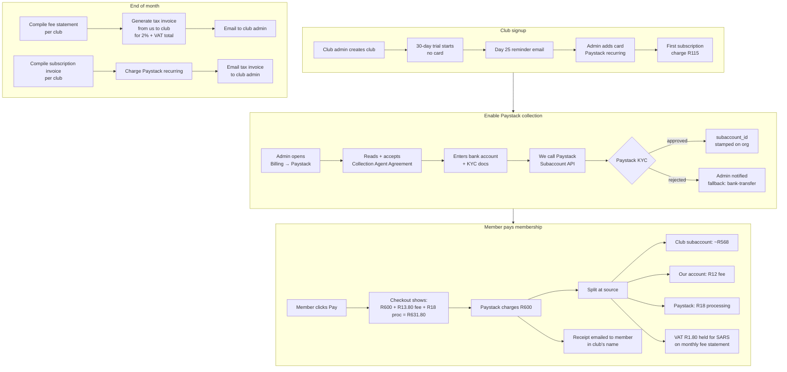

# Platform Billing & Payment Gateway — Design

**Date:** 2026-10-18
**Status:** Approved for spec write-up; implementation plan pending user review of this doc
**Sibling spec:** `2026-10-18-club-membership-manager-design.md` (shares the Paystack webhook branch and the `MembershipInvoice` ledger)

## Goal

Give shootingsports.co.za two revenue streams on top of the free listings and the already-built membership manager:

1. **Platform subscription** — clubs pay a tiered monthly/annual fee to unlock the desk + membership manager + event module.
2. **Transaction platform fee** — a 2% cut (plus VAT on that fee) on every payment collected through our Paystack integration on behalf of a club.

Underpin both with a legally-defensible **Section 54 agency** collection model so that pass-through member money never becomes our turnover for VAT or income tax purposes. Also ship a one-off **R750 single-event product** for ad-hoc organisers who don't run a club.

Out of scope: multi-year billing, prorated downgrades, white-label domains, Paystack Connect-style club-held merchant accounts, member-to-member peer payments, invoice financing.

## Section 54 agency compliance — the tax frame everything else serves

The entire payment design has to make it unambiguous that we are a **collection agent** for the club, not the seller of the entry/membership. Section 54 of the VAT Act says a supply by an agent on behalf of a principal is treated as a supply by the principal; the club (not VAT-registered) is the principal, so no VAT applies to the member fee.

Four design conditions have to hold for this to stick:

| Condition | How this design satisfies it |
|---|---|
| Written agency agreement with each club | Click-through "Collection Agent Agreement" presented during the Paystack enablement wizard; stored as a signed record on `organisations.agency_agreement_signed_at` + full agreement body on `organisations.agency_agreement_version`. Agreement sets price-setting, refund handling, our fee + VAT, gateway-fee recharge. |
| Entry contract is between shooter and club | Public terms updated to say the entry/membership contract is with the club. Member-facing receipt reads **"Receipt from \[Club Name\] — collected on your behalf by shootingsports.co.za (VAT no. \[X\])"**, not a shootingsports tax invoice. |
| Money kept separate in our books | Primary path uses Paystack Subaccounts — money splits at source and never lands in our operating account. Fallback path uses a dedicated pass-through bank account and a `ClubPayable` liability ledger per club (never general income). |
| Separate tax invoice for our fee | Two distinct document types from us to the club: a **subscription tax invoice** (R100/R500/R800 + VAT per cycle) and a **monthly fee statement** (one line per gateway transaction with 2% + VAT per line). Both carry our VAT number and the club's. |

The three agency touchpoints that need an accountant/lawyer sign-off before launch — flagged in-doc as TBD-pending-accountant placeholders in code and copy — are: the agency agreement wording, the member receipt wording, and the fee statement format.

## Decisions (locked)

| Decision | Choice |
|---|---|
| Primary payment routing | **Paystack Subaccounts** — split at source. Member pays, Paystack transfers club's share directly to club's bank account; our 2% platform fee + Paystack's own fee come off the top. Zero reconciliation, strongest agency posture. |
| Fallback payment routing | **Bank-transfer settlement** — if Paystack SA subaccounts prove unviable at feasibility-check time, platform collects into dedicated pass-through account, settles out via `BatchClubPayouts` scheduled command. First payout per calendar month free; **R50 + VAT per subsequent payout** in the same month. |
| Who bears the platform fee + VAT | **Club absorbs.** Member pays the base amount, club receives the base amount less (Paystack fee + 2% platform fee + 15% VAT on that platform fee). |
| Member-side transparency | **Checkout shows the breakdown.** Even though the club absorbs, the member sees `Fee to [Club]: R600 + Platform fee (incl. VAT): R13.80 + Processing: R18.00 = R631.80`. No hidden markups. |
| Tier gating | Member count — Micro ≤ 50, Standard 51–250, Large 251–1,000, "Contact us" over 1,000. All features available on every tier. |
| Tier enforcement | **Soft grace** — email + dashboard banner on overage, 30-day grace window, auto-upgrade at next billing cycle. No hard blocks on new member adds. |
| Subscription billing mechanism | Paystack recurring (tokenised card). Dunning retries at day 1 / 4 / 7 / 14; day 14 → `past_due` (read-only); day 30 → `suspended`. |
| Trial | **30 days free, no card required.** Email reminders at T-5, T-1, T+0. |
| Platform fee rate | **Editable Site Setting** — stored as basis points, default `200` (2%). Platform owner can tune without a code deploy. |
| Payout admin fee | **Editable Site Setting** — default `5000` cents (R50) + VAT, applied to 2nd and later payouts per calendar month on the bank-transfer path. |
| VAT display | Both exclusive and inclusive shown everywhere user-facing. Settings store exclusive cents. |
| Single-event product | Lightweight `Organisation { kind: 'single_event' }` + one `Event`, R750 + VAT = **R862.50** paid upfront, no trial, same 2% + VAT platform fee on entry fees collected via Paystack. |

## Pricing (headline numbers)

Marketing shows exclusive; checkout and tax invoices show inclusive. Both derive from exclusive cents in Site Settings.

| Product | Excl. VAT | Incl. VAT (15%) |
|---|---|---|
| Micro monthly | R100 | **R115** |
| Standard monthly | R500 | **R575** |
| Large monthly | R800 | **R920** |
| Micro annual | R1,000 | **R1,150** |
| Standard annual | R5,000 | **R5,750** |
| Large annual | R8,000 | **R9,200** |
| Single event (one-off) | R750 | **R862.50** |
| Platform fee on gateway txns | 2% of gross | **≈2.3% off the top** (2% fee + 15% VAT on fee) |
| 2nd+ bank-transfer payout per calendar month | R50 | **R57.50** |

Member cap by tier: Micro ≤ 50 active members, Standard 51–250, Large 251–1,000.

## Actors

- **Platform owner** (`is_staff`): new "Platform billing" tab under Site Settings. New "Platform revenue" admin dashboard. Approves KYC-flagged subaccount applications.
- **Club admin** (`OrganisationUserRole::Admin`): new "Billing" nav section on `/desk`. Signs the agency agreement, configures Paystack Subaccount, picks tier/interval, sees usage + current period invoice, downloads tax invoices, requests payouts (bank-transfer fallback), cancels subscription.
- **Member paying online**: sees breakdown at checkout; receives receipt in the club's name.
- **Ad-hoc single-event organiser**: signs up at `/organise`, pays R862.50 up front, gets a trimmed desk (one event, no clubs, no members).

## Flows (Mermaid)



## Payment routing — primary path (Paystack Subaccounts)

```php
// Simplified initialise call
$paystack->initializeTransaction([
    'amount' => $invoice->amount_cents,                 // R600 base
    'email'  => $member->email,
    'subaccount' => $organisation->paystack_subaccount_id,
    'bearer' => 'subaccount',                           // club bears Paystack fee
    'transaction_charge' => $platformFeeInclVatCents,   // 2% + VAT, our take
    'metadata' => [
        'purpose' => 'club_membership',
        'invoice_id' => $invoice->id,
        'organisation_id' => $organisation->id,
    ],
]);
```

- Paystack splits the gross at source: Paystack fee + our `transaction_charge` come off before the net lands in the club's subaccount.
- The club's share settles via Paystack's normal payout schedule to the bank account on file at the subaccount.
- We never touch the club's money. Agency posture: untouchable.

## Payment routing — fallback (bank-transfer settlement)

Triggered per club by `organisations.payout_method = 'bank_transfer'`. Used if Paystack SA subaccounts prove unavailable at feasibility-check time, or if a specific club can't KYC.

- Member charges land in our platform Paystack account.
- Webhook creates a `ClubPayable` row: `organisation_id, invoice_id, gross_cents, platform_fee_cents, platform_fee_vat_cents, gateway_fee_cents, net_due_cents`.
- `net_due_cents = gross - platform_fee - platform_fee_vat - gateway_fee` — the money we owe the club.
- Desk billing surface shows settlement balance. "Request payout" creates a `PlatformPayout` row (status `requested`).
- `BatchClubPayouts` scheduled command picks up `requested` payouts nightly, groups by club, produces a nightly EFT batch CSV for the platform owner to upload to their bank.
- First payout per calendar month per club: free. 2nd+: R50 + VAT fee deducted from the payout amount, booked as income on our side.
- A dedicated **pass-through bank account** holds all `net_due` money (not our operating account). Required paperwork condition for agency posture.

## Tier model

| Tier | Monthly (excl / incl) | Annual (excl / incl) | Active member ceiling |
|---|---|---|---|
| Micro | R100 / R115 | R1,000 / R1,150 | ≤ 50 |
| Standard | R500 / R575 | R5,000 / R5,750 | 51–250 |
| Large | R800 / R920 | R8,000 / R9,200 | 251–1,000 |
| Enterprise | contact us | contact us | > 1,000 |

Annual pricing = ~17% off (two months free).

### Tier enforcement

- Nightly `EnforceTierOverages` command recomputes `organisations.active_member_count` (ClubMember status in `[Active, Suspended]`).
- When count crosses current tier ceiling: email all `canManageClubMembers` users at the club + show dashboard banner on `/desk`. Stamp `organisations.tier_grace_ends_at = now + 30 days` (only if not already set).
- On grace expiry: auto-upgrade. Change `subscription.tier`, next recurring Paystack charge is the new amount, send upgrade confirmation email with the new tax invoice.
- Downgrades: manual only, take effect at next period boundary. Upgrades: user-initiated changes take effect immediately with prorated delta charged on next billing day.

## Trial & signup

- `/signup` adds "Create a club" option alongside the existing shooter/MD/supplier roles.
- Club creation → PlatformSubscription `status = trial`, `trial_ends_at = now + 30 days`, no payment method required.
- Reminders: T-5, T-1, T+0 emails from `NotifyTrialEnding`.
- Trial expires without payment method → `status = trial_expired`, read-only mode. 30 days read-only → `status = cancelled`, data retained 90 days then anonymised.

## Subscription billing (platform ↔ club)

**New model:**

```
PlatformSubscription {
  organisation_id (unique)
  tier: enum [micro, standard, large]
  interval: enum [monthly, annual]
  status: enum [trial, trial_expired, active, past_due, suspended, cancelled]
  paystack_authorization_code
  current_period_start, current_period_end
  trial_ends_at
  cancel_at_period_end: bool
  cancelled_at
}
```

**Daily commands:**

- `BillRecurringSubscriptions` — bills subscriptions whose `current_period_end` is today, idempotent on `(subscription_id, period_start)`. Charges via Paystack recurring using stored authorization code.
- `RetryPastDueSubscriptions` — walks the dunning schedule for `past_due` subscriptions.
- `EnforceTierOverages` — see above.
- `NotifyTrialEnding` — T-5 / T-1 / T+0 per subscription.

**Dunning schedule** (editable Site Setting, default below):
- Day 1: first retry.
- Day 4: second retry.
- Day 7: third retry.
- Day 14: fourth retry → fail → `status = past_due`, read-only mode (no new member adds, no new events, no new invoices).
- Day 30 past_due: `status = suspended`, desk shows a payment-required page only; public pages for the club stay live (don't punish the shooter).

**Cancellation:** anytime from desk; `cancel_at_period_end = true`; club keeps access until period end; data retained 90 days post-cancellation then anonymised.

## Single-event product

- `/organise` public signup form: name, email, event title, event date, venue (via existing Venue picker). No club context, no members.
- Creates `User` + `Organisation { kind: 'single_event' }` + `Event` + a one-off `PlatformInvoice` for R750 + VAT (R862.50).
- Paystack one-off charge upfront (not recurring). Event stays `Draft` until payment clears.
- Trimmed desk: Club nav group hidden, only Events + Entries visible.
- 2% + VAT platform fee applies to any entry fees collected via Paystack for the event. Same subaccount wizard available but optional (can collect offline).

## Document model

Every piece of paper the system emits has a precise tax identity. This is where the agency framing lives in practice.

| Document | Issued by | Issued to | Nature | Trigger |
|---|---|---|---|---|
| Membership statement | Club (via us as agent) | Member | **Not** a tax invoice (club not registered); headed "Receipt from \[Club\] — collected by shootingsports.co.za" | Payment success webhook |
| Platform subscription tax invoice | Us | Club | VAT tax invoice for R115/R575/R920 | Successful Paystack recurring charge |
| Platform fee statement + tax invoice | Us | Club | VAT tax invoice summarising all gateway transactions the 2% + VAT applied to in the period | Monthly, 1st of each month |
| Payout statement | Us (as agent) | Club | Agent settlement statement showing gross collected, platform fee, VAT on fee, Paystack fee recharge, net paid | Bank-transfer path only; per payout |
| Payout fee tax invoice | Us | Club | VAT tax invoice for R57.50 payout admin fee | Only for 2nd+ payouts per calendar month |
| Collection Agent Agreement | Us + Club | — (self-signed record) | Legal agreement, versioned | Signed once at Paystack enablement; new version requires re-acceptance |
| Single-event tax invoice | Us | Organiser | VAT tax invoice for R862.50 | On signup payment success |

All our tax invoices carry our VAT number, our registered name/address, and the club's name/VAT number (if provided). All agency-collected member receipts carry the club's name/registration and "collected by \[us\]" footer.

### Receipt / invoice wording — TBD-pending-accountant

Three Blade templates ship with placeholder copy flagged `{{-- TBD: finalise wording with accountant/lawyer --}}`:

- `resources/views/receipts/membership-agent-receipt.blade.php`
- `resources/views/invoices/platform-subscription-tax-invoice.blade.php`
- `resources/views/invoices/platform-fee-statement.blade.php`

Code paths are unblocked; copy is cheap to swap once reviewed.

## Data model

### New models

```
PlatformSubscription        — see above
PlatformInvoice             — one row per subscription cycle
PlatformFeeStatement        — monthly roll-up per club
PlatformFeeLine             — one line per gateway transaction, pivot to statement
PlatformPayout              — bank-transfer fallback only
PlatformPayoutFee           — the R57.50 charges, booked as income
ClubPayable                 — bank-transfer fallback only, liability ledger
AgencyAgreementAcceptance   — audit trail of agreement signatures per version
```

### Changes to existing models

```
organisations:
  + paystack_subaccount_id (string, nullable, unique)
  + paystack_subaccount_status (enum: pending, active, rejected, suspended)
  + payout_method (enum: paystack_subaccount, bank_transfer, default paystack_subaccount)
  + agency_agreement_signed_at (timestamp, nullable)
  + agency_agreement_version (string, nullable)
  + active_member_count (int, cached, denormalised)
  + tier_grace_ends_at (date, nullable)

membership_invoices:
  + platform_fee_cents (int, default 0)
  + platform_fee_vat_cents (int, default 0)
  + gateway_fee_cents (int, default 0)
  + net_to_club_cents (int, default 0)
```

### Settings (Site Settings)

| Key | Type | Default | Meaning |
|---|---|---|---|
| `platform.fee_bps` | int | `200` | Platform fee basis points (200 = 2%) |
| `platform.vat_bps` | int | `1500` | VAT basis points (1500 = 15%) |
| `platform.payout_admin_fee_cents` | int | `5000` | 2nd+ monthly payout fee, excl VAT |
| `platform.trial_days` | int | `30` | Trial window length |
| `platform.dunning_retry_days` | json | `[1,4,7,14]` | Day offsets for recurring charge retries |
| `platform.grace_window_days` | int | `30` | Tier overage grace |
| `platform.tier_prices_cents` | json | `{"micro":{"monthly":10000,"annual":100000},"standard":{"monthly":50000,"annual":500000},"large":{"monthly":80000,"annual":800000}}` | Headline prices, excl VAT |
| `platform.single_event_price_cents` | int | `75000` | One-off R750 excl VAT |
| `platform.tier_member_caps` | json | `{"micro":50,"standard":250,"large":1000}` | Active member ceilings |

All read via existing `settings` table + `applyFromSettings()` pattern. Admin UI tab: Site Settings → Platform billing.

## Scheduled commands

```
BillRecurringSubscriptions       daily 02:00
RetryPastDueSubscriptions        daily 02:30
EnforceTierOverages              daily 03:00
NotifyTrialEnding                daily 09:00
CompileMonthlyFeeStatements      monthly, 1st at 05:00
BatchClubPayouts                 nightly 01:00 (bank-transfer path only)
```

## Admin surfaces

### Platform owner (`/admin`)

- **Platform billing settings** — new tab under Site Settings. Edits every row in the settings table above.
- **Platform revenue dashboard** — new Filament page: MRR, ARR, trial-to-paid conversion, churn, platform fee revenue (fee + VAT split), outstanding payables, failed charge count, subaccount KYC queue.
- **Subaccount approvals** — only used if any club is `paystack_subaccount_status = pending` and we need to intervene.

### Club admin (`/desk`)

New nav group **Billing** (sort: last):

- **Subscription** — current tier, usage bar vs cap, next billing date, change tier, cancel, view/download past tax invoices.
- **Paystack** — Collection Agent Agreement status, subaccount wizard (or bank-transfer toggle), bank account on file.
- **Payouts** (bank-transfer path only) — settlement balance, "Request payout" button, history of past payouts, download agent statements.
- **Fee statements** — monthly fee statement + tax invoice archive.

### Member-facing (public)

- `/my-memberships` already exists (phase 3 of membership manager). Checkout breakdown now shows the three-way split (`fee to club` / `platform fee incl VAT` / `processing`).
- Payment success page shows the agent receipt in the club's name.

## Testing strategy

### Pest (feature tests)

Per phase (see plan). Key assertions:

- `PaystackController` branches correctly on `subaccount` presence; split amounts match basis-point maths.
- `BillRecurringSubscriptions` idempotent on `(subscription_id, period_start)`.
- Dunning schedule triggers correct status transitions at correct day offsets.
- `EnforceTierOverages` sets `tier_grace_ends_at` only once, auto-upgrades on expiry.
- Agency agreement acceptance is required before `paystack_subaccount_id` can be stamped.
- `ClubPayable` liability math holds for the bank-transfer path on every webhook.
- Fee statement VAT math: 2% of R600 = R12, VAT 15% of R12 = R1.80, total R13.80.
- Payout admin fee only applied from the 2nd payout per calendar month.

### Playwright

- Club admin signs up → sees trial banner → day 25 email → adds card → sees subscription active.
- Admin enables Paystack → declines agreement → Paystack enablement blocked.
- Admin enables Paystack → accepts agreement → fills bank details → sees `pending` subaccount status.
- Member checkout shows three-line breakdown with correct cents.
- Admin changes tier manually → next billing shows new amount in preview.
- Overage grace banner appears when active count crosses ceiling; disappears on upgrade.
- `/organise` single-event flow end-to-end.

## Feasibility checks required before build

Three questions must be answered before Phase 1 starts. If any answer is "no", we fall back to the bank-transfer path as the primary and the subaccount path becomes a later enhancement — no architecture change needed.

1. **Does Paystack SA support subaccount creation for SA merchants in 2026?** Documentation + dev account probe.
2. **Does Paystack SA support `transaction_charge` alongside `subaccount` on `initializeTransaction`?** Dev account probe.
3. **What are the per-subaccount KYC requirements** (CIPC reg? bank letter? director ID?) and are they workable for a volunteer club secretary to complete?

## Implementation plan (phases)

To be fleshed out in the `writing-plans` step. Rough outline:

- **Phase 0** — Feasibility probe (above). Documented go/no-go on subaccounts.
- **Phase 1** — Platform billing data model + Site Settings tab + VAT-inclusive helpers. No user-facing flow yet.
- **Phase 2** — PlatformSubscription + Paystack recurring + trial + dunning. Club admin can start a trial and go to paid.
- **Phase 3** — Collection Agent Agreement + Paystack Subaccount wizard. Club can enable gateway collection.
- **Phase 4** — Member checkout breakdown + agent receipt + fee statement compilation. End-to-end gateway path works with correct tax posture.
- **Phase 5** — Bank-transfer fallback (`ClubPayable` + `PlatformPayout` + `BatchClubPayouts` + payout admin fee).
- **Phase 6** — Tier enforcement (overage grace + auto-upgrade).
- **Phase 7** — Single-event product.
- **Phase 8** — Platform revenue admin dashboard + fee statement archive.

## Risks & open questions

| Risk | Mitigation |
|---|---|
| Paystack SA subaccounts unavailable | Bank-transfer fallback is a first-class citizen in the data model, not an afterthought. |
| Agency framing judged insufficient by SARS | Three touchpoints flagged for accountant/lawyer review before launch. Optional SARS binding ruling at scale. |
| Clubs ignore the "transparent breakdown" at checkout and complain about hidden surcharges | Member sees breakdown pre-payment, not post. Receipt also itemises. |
| Chargebacks on member payments | Chargeback fees deducted from the club's next payout (bank-transfer path) or from their subaccount (primary path). Must be in the Collection Agent Agreement. |
| Clubs get stuck in `past_due` because the recurring card fails and the admin isn't checking email | Dashboard banner shown on every desk page in `past_due`; subsequent emails ramp up urgency. |
| Platform owner forgets to charge VAT on payout admin fee | Mandatory computation path through a `vatInclusiveCents()` helper used everywhere; unit test proves it. |

## Known holes to resolve in the plan step

- Chargeback flow details.
- Refund flow (member-initiated vs secretary-initiated).
- What happens to open invoices and in-flight payments when a club cancels.
- Whether to support partial payments on membership invoices.
- Whether platform fee rate can be overridden per club (default: no, global rate only).
- Email template inventory — currently 6 new emails identified, probably more fall out of the plan.

## Appendix: pass-through money example

Member pays R600 for a Senior membership at Pretoria Rifle Club. Club uses Paystack Subaccounts path. Platform fee rate 2%, VAT 15%.

```
Member checkout shows:
  Membership fee to Pretoria Rifle Club     R600.00
  Platform fee (incl. VAT)                   R13.80
  Payment processing                         R18.00    ← Paystack estimate
  ────────────────────────────────────────────────────
  Total                                     R631.80

Paystack splits R600 at source:
  Paystack fee (2.9% + R1)                   R18.40    → Paystack
  Platform fee (transaction_charge)          R13.80    → shootingsports
  Net to club subaccount                    R567.80    → Pretoria Rifle Club

shootingsports books:
  Agent liability (gross)                   R600.00    (never actually held — direct split)
  Agency fee income                          R12.00    → income statement
  VAT output                                  R1.80    → SARS payable (via monthly fee statement VAT)

Pretoria Rifle Club books (clubs that bother to keep books):
  Membership revenue                        R600.00
  Collection costs                           R32.20    (R18.40 Paystack + R13.80 agent fee)
  Net cash received                         R567.80
```

The R600 line never appears in our turnover. The R12 does.
